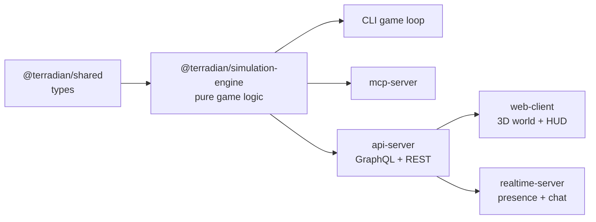

# Terradian

> A life-simulation game: create a Terrestrial, get a procedurally generated family, and live a life of school, work, travel and play on a real-world map.

---

## 🧩 Problem Statement

Most life-simulation games are either shallow (a stream of random pop-ups with no memory) or closed (no way for other tools or AI agents to play, inspect or extend them). Terradian is built the other way round: a deterministic, testable simulation engine at the core, with every other surface (CLI, MCP server, APIs, 3D web client, multiplayer) layered on top of it.

It is also a deliberate learning vehicle for system design: state machines, event systems, ledgers, GraphQL vs REST, OAuth2, pub/sub, MCP and LLM-driven content, each introduced in a module where it fits naturally.

## 📋 PM Brief

| Field               | Detail                                                                                                                                   |
| ------------------- | ---------------------------------------------------------------------------------------------------------------------------------------- |
| **Goal**            | A full life (birth to death) that is replayable from a seed and playable by humans and AI agents alike                                   |
| **Users**           | Players (CLI, then web), AI agents via MCP, and developers extending the engine                                                          |
| **Success Metrics** | Same seed + same choices = identical life; a 0-to-death headless run with no invariant violations; Claude can play a week through MCP    |
| **Constraints**     | All randomness through one seeded RNG; pure, immutable game logic; content in data files; Google Map Tiles API policies for the 3D world |

---

## 🏗️ Architecture

See [docs/architecture.md](docs/architecture.md) for the full picture.



---

## 🛠️ Tech Stack

| Layer         | Tool                                                                                                 |
| ------------- | ---------------------------------------------------------------------------------------------------- |
| Language      | TypeScript (strict)                                                                                  |
| Monorepo      | pnpm workspaces                                                                                      |
| Tests         | Vitest                                                                                               |
| Lint / format | ESLint, Prettier                                                                                     |
| CI            | GitHub Actions                                                                                       |
| Planned       | MCP TypeScript SDK, GraphQL, Postgres, OAuth2, Three.js + Google Photorealistic 3D Tiles, WebSockets |

---

## 📦 Package Status

| Package                      | Status         | Contents                                                                 |
| ---------------------------- | -------------- | ------------------------------------------------------------------------ |
| `packages/shared`            | 🟢 Active      | Terrestrial, Family and (placeholder) event types                        |
| `packages/simulation-engine` | 🟡 In progress | Seeded RNG, Terrestrial creation (module 1), family generator (module 2) |
| `packages/mcp-server`        | ⚪ Planned     | Module 8                                                                 |
| `packages/api-server`        | ⚪ Planned     | Modules 14-16                                                            |
| `packages/web-client`        | ⚪ Planned     | Modules 17-18                                                            |
| `packages/realtime-server`   | ⚪ Planned     | Module 22                                                                |

---

## 🚀 How to Run

Requires Node 20+ and pnpm 9.

1. Clone the repo:

```bash
   git clone https://github.com/neelabja-saha/terradian
   cd terradian
```

2. Install dependencies:

```bash
   pnpm install
```

3. Run the checks:

```bash
   pnpm typecheck
   pnpm lint
   pnpm test
```

There is no playable entry point yet. The CLI game loop (`pnpm play`) arrives in module 7.

---

## 📸 Sample Output

```ts
import { createRng, createTerrestrial, generateFamily } from "@terradian/simulation-engine";

const rng = createRng("my-seed");
const me = createTerrestrial(
  {
    id: "t-1",
    name: "Asha Rao",
    gender: "female",
    birthDay: 0,
    location: { city: "Kolkata", region: "West Bengal", country: "India" },
    socioeconomicTier: "middle",
  },
  0,
  rng,
);
const family = generateFamily(me, rng, 0);
// Same seed -> same Terrestrial and same family, every time.
```

---

## 🧭 V2 Roadmap

The build is split into 23 modules across 7 phases. See [docs/ROADMAP.md](docs/ROADMAP.md).

---

## 🔄 PM Retrospective

A running log of design decisions lives in [docs/PM_RETROSPECTIVE.md](docs/PM_RETROSPECTIVE.md).

---

## 📚 Related Docs

- [PRD](docs/PRD.md)
- [Architecture](docs/architecture.md)
- [Roadmap](docs/ROADMAP.md)
- [PM Retrospective](docs/PM_RETROSPECTIVE.md)
