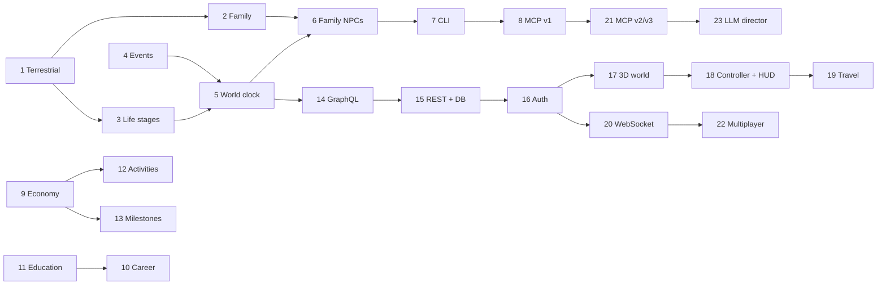

# Roadmap — Terradian

23 modules across 7 phases. Each module is built, tested and committed before the next starts. Detailed per-module requirements are kept in the module prompt pack.

**Status key:** ✅ Done · 🟡 In progress · ⚪ Not started

---

## Phase 1 — Core simulation

| #   | Module                                | Package           | Status |
| --- | ------------------------------------- | ----------------- | ------ |
| 1   | Terrestrial                           | simulation-engine | ✅     |
| 2   | Family generator                      | simulation-engine | ✅     |
| 3   | Life-stage state machine              | simulation-engine | ⚪     |
| 4   | Life events: definitions and resolver | simulation-engine | ⚪     |
| 5   | World clock and tick engine           | simulation-engine | ⚪     |
| 6   | Family NPC simulation                 | simulation-engine | ⚪     |
| 7   | CLI game loop                         | simulation-engine | ⚪     |
| 8   | MCP server v1                         | mcp-server        | ⚪     |

**Phase goal:** a full life can be simulated headlessly, played in the terminal, and played by Claude through MCP.

## Phase 2 — Game systems

| #   | Module                             | Package           | Status |
| --- | ---------------------------------- | ----------------- | ------ |
| 9   | Spark points economy               | simulation-engine | ⚪     |
| 10  | Work and career                    | simulation-engine | ⚪     |
| 11  | School and college                 | simulation-engine | ⚪     |
| 12  | Activities: study, play, socialize | simulation-engine | ⚪     |
| 13  | Milestones and progression         | simulation-engine | ⚪     |
| 14  | GraphQL API                        | api-server        | ⚪     |

## Phase 3 — Backend

| #   | Module                   | Package    | Status |
| --- | ------------------------ | ---------- | ------ |
| 15  | Persistence and REST API | api-server | ⚪     |
| 16  | Auth (OAuth2)            | api-server | ⚪     |

## Phase 4 — 3D client

| #   | Module                          | Package    | Status |
| --- | ------------------------------- | ---------- | ------ |
| 17  | 3D world renderer               | web-client | ⚪     |
| 18  | First-person controller and HUD | web-client | ⚪     |

## Phase 5 — Live world

| #   | Module                               | Package                        | Status |
| --- | ------------------------------------ | ------------------------------ | ------ |
| 19  | Travel and location events           | simulation-engine + web-client | ⚪     |
| 20  | Live updates (WebSocket) and pub/sub | api-server + web-client        | ⚪     |
| 21  | MCP v2 and v3                        | mcp-server                     | ⚪     |

## Phase 6 — Multiplayer

| #   | Module                        | Package         | Status |
| --- | ----------------------------- | --------------- | ------ |
| 22  | Multiplayer presence and chat | realtime-server | ⚪     |

## Phase 7 — AI content

| #   | Module             | Package                        | Status |
| --- | ------------------ | ------------------------------ | ------ |
| 23  | LLM event director | simulation-engine + mcp-server | ⚪     |

---

## Dependencies and ordering notes

- **Education before career:** module 10's eligibility rules need education history from module 11. Build 11 first, or stub education in 10.
- **Ledger first:** modules 12, 13 and 19 record spark points, so module 9 must be complete before them.
- **Keep surfaces current:** modules 9-13 should extend the CLI (7) and MCP tools (8) as they land.
- **Replay needs RNG state:** module 5 saves `rng.getState()` alongside the world state (added in module 1).

## Cross-cutting passes

Run at any time: a **docs pass** (bring README and docs in line with code), a **review pass** (invariants, missing tests, mutation, hard-coded content) and a **balance pass** (simulate 1,000 lives and inspect distributions).
