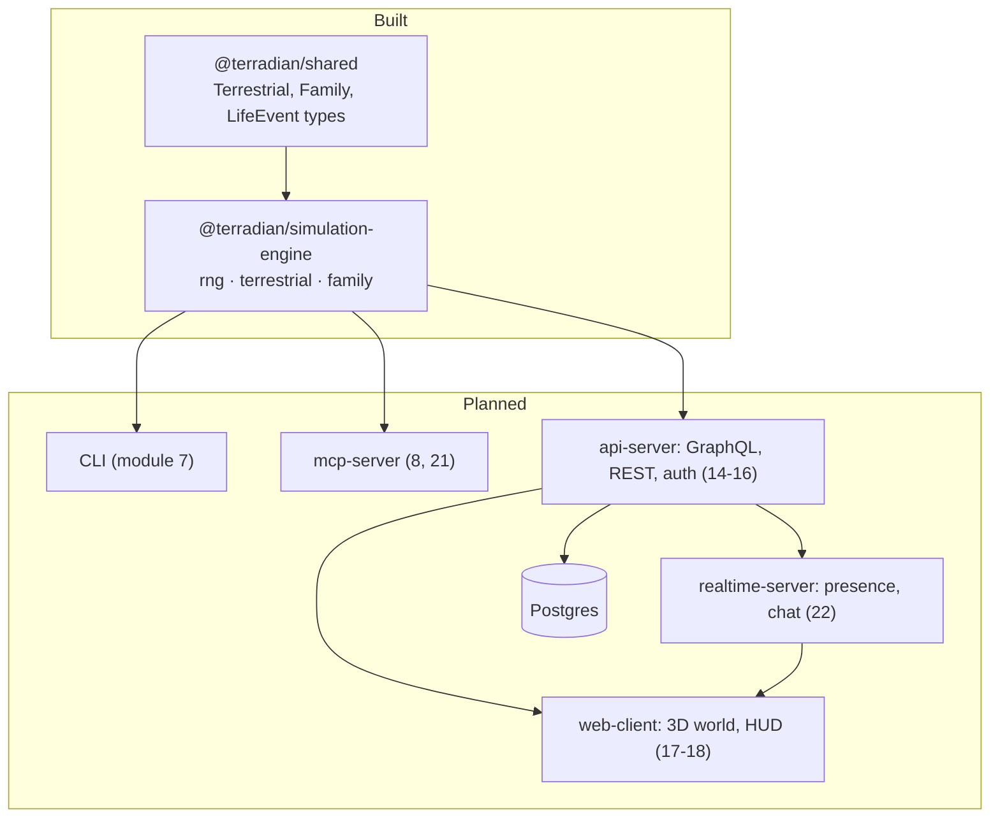
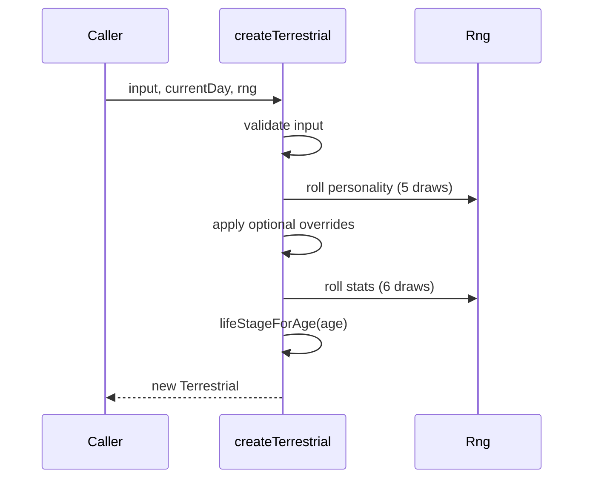

# Architecture — Terradian

Detailed diagrams for individual systems live in [architecture/](architecture/) and design docs in [design/](design/). This page is the overview.

---

## Principles

1. **Engine first.** All game rules live in `@terradian/simulation-engine`, a pure library. Every other package (CLI, MCP, APIs, clients) calls it; none re-implements rules.
2. **Deterministic.** All randomness goes through the seeded `Rng` in `packages/simulation-engine/src/rng.ts`. Its position can be saved with `getState()` and restored with `restoreRng()`, so a saved game replays exactly. `Math.random()` is never used.
3. **Pure and immutable.** Engine functions take state and return new state. They never mutate inputs and never do I/O.
4. **Shared types.** Types used across packages live in `@terradian/shared`.
5. **Content as data.** Event tables, name lists and job catalogues live in data files, not in logic.

---

## Packages



| Package                     | Responsibility                                                                     |
| --------------------------- | ---------------------------------------------------------------------------------- |
| `shared`                    | Type definitions only. No runtime logic.                                           |
| `simulation-engine`         | All game rules. Pure functions, no I/O.                                            |
| `mcp-server` (planned)      | Exposes the engine as MCP tools and resources for AI agents.                       |
| `api-server` (planned)      | GraphQL and REST, persistence via repositories, OAuth2.                            |
| `web-client` (planned)      | Three.js renderer on Google Photorealistic 3D Tiles, first-person controller, HUD. |
| `realtime-server` (planned) | Presence, interest management, chat. Server-authoritative.                         |

---

## Simulation engine today

```
packages/simulation-engine/src/
├── rng.ts                 # seeded RNG with save/restore
├── util.ts                # clamp, ageInYears, DAYS_PER_YEAR
├── terrestrial/
│   ├── terrestrial.ts     # createTerrestrial (validation, personality overrides)
│   ├── personality.ts     # Big Five roll
│   ├── stats.ts           # stat roll; wealth and health depend on tier
│   └── life-stage.ts      # lifeStageForAge
└── family/
    ├── family.ts          # generateFamily
    ├── closeness.ts       # directed closeness edges
    └── name-data.ts       # loads and validates data/names.json

packages/simulation-engine/data/
└── names.json             # first names and surnames by country, plus "default"
```

### Creating a Terrestrial



Personality is always rolled before overrides are applied, so the RNG is consumed the same way whether or not the player set any traits. This keeps later draws (stats, family) stable.

### Time model

Time is an integer day index. Day 0 is the epoch; a Terrestrial's `birthDay` is the day they were born. A year is 365 days (`DAYS_PER_YEAR`). The world clock (module 5) will advance one day per tick.

---

## Quality gates

`pnpm typecheck`, `pnpm lint`, `pnpm format:check` and `pnpm test` run locally and in GitHub Actions on pushes and PRs to `main` and `develop`. Tests sit next to the code as `*.test.ts`.
